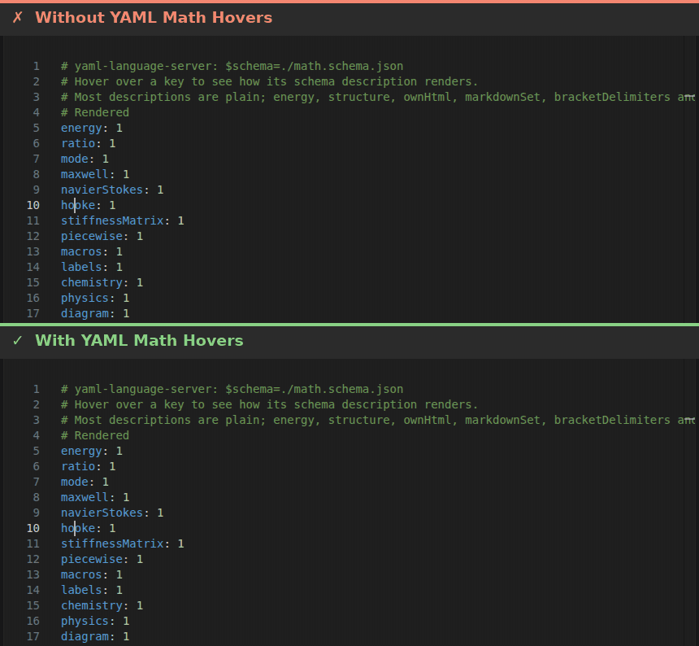

# YAML Math Hovers

Renders LaTeX math in the JSON schema descriptions that the [YAML extension](https://marketplace.visualstudio.com/items?itemName=redhat.vscode-yaml) shows in hovers.



## Requirements

The YAML extension must provide the `registerHoverTransformer` extension API. Until a release of the YAML extension includes it, this extension does nothing, and shows a warning once per version of the YAML extension.

## Writing equations

Use `$...$` for inline equations and `$$...$$` for display equations, in both `markdownDescription` and plain `description` fields, as in GitHub and the VS Code Markdown preview:

```json
{
  "type": "object",
  "properties": {
    "energy": {
      "type": "number",
      "markdownDescription": "Energy is $E = mc^2$.\n\n$$\nE = \\frac{1}{2}mv^2\n$$"
    }
  }
}
```

Backslashes must be escaped in JSON strings, as in `\\frac` above and in the examples below.

- Inline equations follow Pandoc's rules, so that prices like `$5 or $10` remain text: `$` must not be followed by a space when it opens an equation, nor preceded by one when it closes it. Spaces on both sides are accepted around TeX syntax, as in `$ \\epsilon_{r} $`.
- Display equations directly in a paragraph get a centered line of their own. Display equations can span lines when `$$` is on lines of its own.
- Escaped dollars, code, and link destinations keep their Markdown meaning.
- Plain descriptions are escaped by the YAML language server before they reach the hover; this extension recovers the TeX of their equations. Inline equations in plain descriptions must be on a single line.
- In a corner case, an equation in a `markdownDescription` loses its backslashes: only if every backslash in its paragraph, also in other equations, precedes punctuation, and the paragraph has no other Markdown such as `*emphasis*`. The paragraph then reads exactly like a `description` escaped by the language server, which the hover cannot tell apart, so it is unescaped. For example, `$\\{1, 2\\}$` alone in a paragraph renders without its braces; write `$\\lbrace 1, 2 \\rbrace$` instead.
- `\\(...\\)` and `\\[...\\]` are not math delimiters, because the language server's escaping can produce them from ordinary parentheses and brackets in a `description`. Use `$...$` and `$$...$$`.

Supported notation includes AMS mathematics, matrices, aligned equations, custom commands, `mathtools`, cases, cancellation, colors, physics notation, chemistry (`mhchem`), and commutative diagrams. Macros and labels are scoped to one description. Document preambles, `\usepackage`, TikZ, and external files are not supported.

## Behavior

- Equations are rendered locally to SVG images with a bundled [MathJax](https://www.mathjax.org/); nothing is sent to a network service. This works in desktop VS Code and in VS Code for the Web.
- Invalid or unsupported equations remain as source.
- To keep hovers responsive and below VS Code's size limit, a description renders at most 64 equations of up to 16,384 characters of TeX each, and at most 90,000 characters of Markdown, and a hover stops rendering after about 250 ms. Equations beyond these limits remain as source.
- Colors follow the light, dark, or high-contrast theme category.
- To find out why an equation remains as source, open **View → Output** and select **YAML Math Hovers**. Each hover logs its TeX errors as warnings and equations beyond the limits as info, with the file and line of the hovered key.

## Settings

- `yamlMath.enable`: Render LaTeX math in schema descriptions shown in YAML hovers. Defaults to `true`.

## Development

```sh
npm install
npm run test:unit
# Check in Chromium that every fixture hover image displays; writes out/images/gallery.html
npm run test:images
# Desktop: needs a built checkout of the YAML extension with the hover transformer API
# at ../vscode-yaml, or at VSCODE_YAML_PATH.
npm run test:integration
# Web: needs a folder that contains a copy (not a symbolic link) of that built extension
# at test/web/extensions, or at VSCODE_YAML_EXTENSIONS.
npm run test:web
```
